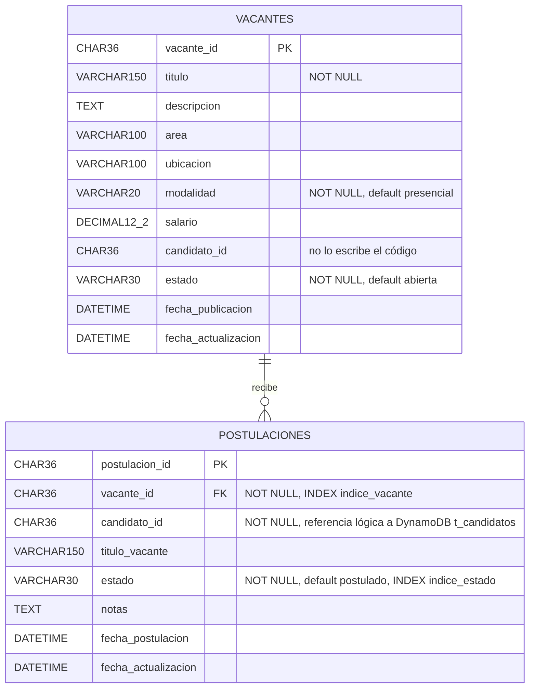
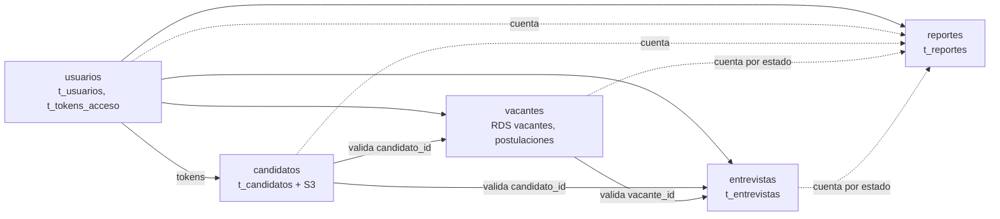

# Diseño de bases de datos

Este documento describe las bases de datos que usa realmente el código de los cinco microservicios (stage `dev`, región `us-east-1`). Se obtuvo de `serverless.yml`, `common/dynamo.py`, `common/rds.py`, `sql/schema.sql` y los handlers de cada servicio.

## Estrategia de multi-tenancy

| Almacén | Servicios | Estrategia de aislamiento |
|---|---|---|
| DynamoDB | usuarios, candidatos, entrevistas, reportes | `tenant_id` es la **partition key** de cada tabla de negocio. El `tenant_id` se toma siempre del token validado, nunca del body ni de la URL. |
| RDS MySQL | vacantes (escritura) y postulaciones; lectura desde entrevistas y reportes | Patrón **Single Database, Multiple Schemas**: una sola instancia RDS con un schema por tenant (`tenant_1`, `tenant_2`, `tenant_3`). |
| S3 | candidatos | Bucket `cs2032-candidatos-cv-dev-<account-id>`, con prefijo `<tenant_id>/<candidato_id>/cv.pdf`. |

Todas las tablas DynamoDB usan `BillingMode: PAY_PER_REQUEST`. Los tenants cargados por los scripts de datos son `tenant_1`, `tenant_2` y `tenant_3`.

---

## 1. Usuarios y autenticación (DynamoDB)

### 1.1 Tabla `t_usuarios-dev`

| Elemento | Valor |
|---|---|
| Partition key | `tenant_id` (S) |
| Sort key | `usuario_id` (S, uuid4) |
| GSI `indice_email` | PK `email` (S); sin sort key; proyección `ALL` |

El GSI `indice_email` permite el login sin conocer el tenant: el correo es único en todo el sistema (se valida en `crear_usuario`).

| Campo | Tipo | Obligatorio | Descripción |
|---|---|---|---|
| `tenant_id` | S | Sí (PK) | Tenant al que pertenece; sale del token del administrador que crea el usuario. |
| `usuario_id` | S | Sí (SK) | uuid4 generado por el servicio. |
| `nombre` | S | Sí | Texto no vacío (se aplica `strip`). |
| `email` | S | Sí | Se guarda en minúsculas; único global (GSI). |
| `password_hash` | S | Sí | Formato `pbkdf2_sha256$310000$<salt_hex>$<hash_hex>`. Los hashes legados (sha256 hexadecimal sin sal) se migran a PBKDF2 en el siguiente login. Nunca se devuelve en la API. |
| `rol` | S | Sí | `administrador` o `reclutador` (por defecto `reclutador`). |
| `fecha_registro` | S | Sí | ISO 8601 UTC. |

```json
{
  "tenant_id": "tenant_1",
  "usuario_id": "3f1c9a52-7b0e-4d6a-9a8e-0c5d2b7f4e11",
  "nombre": "Lucía Ramos",
  "email": "lucia.ramos@empresa1.example",
  "password_hash": "pbkdf2_sha256$310000$9f2a...c1$5be0...7d",
  "rol": "administrador",
  "fecha_registro": "2026-10-02T14:31:08.512340+00:00"
}
```

### 1.2 Tabla `t_tokens_acceso-dev`

| Elemento | Valor |
|---|---|
| Partition key | `token` (S, uuid4) |
| Sort key | no tiene |
| GSI | no tiene |
| TTL | atributo `ttl` habilitado |

Esta tabla usa `token` como partition key (y no `tenant_id`) porque cada petición llega solo con el token. Cada item incluye el `tenant_id` y es el que usan todos los microservicios (`common/auth.py`, copia idéntica) para resolver el tenant. Se emiten dos tipos: `acceso` (15 minutos) y `refresh` (7 días).

| Campo | Tipo | Obligatorio | Descripción |
|---|---|---|---|
| `token` | S | Sí (PK) | uuid4. |
| `tipo` | S | Sí | `acceso` o `refresh`. Un refresh no sirve en endpoints protegidos. |
| `tenant_id` | S | Sí | Tenant del usuario. |
| `usuario_id` | S | Sí | Usuario dueño del token. |
| `expira` | N | Sí | Epoch en segundos; se compara contra la hora actual. |
| `ttl` | N | Sí | Igual a `expira`; DynamoDB borra el item automáticamente al vencer. |
| `fecha_expiracion` | S | Sí | ISO 8601, por compatibilidad. |

```json
{
  "token": "b7d3e0a4-52c1-4f7e-8d90-1a6c3e9f2b48",
  "tipo": "acceso",
  "tenant_id": "tenant_1",
  "usuario_id": "3f1c9a52-7b0e-4d6a-9a8e-0c5d2b7f4e11",
  "expira": 1795012345,
  "ttl": 1795012345,
  "fecha_expiracion": "2026-11-17T15:12:25+00:00"
}
```

---

## 2. Candidatos (DynamoDB + S3)

### Tabla `t_candidatos-dev`

| Elemento | Valor |
|---|---|
| Partition key | `tenant_id` (S) |
| Sort key | `candidato_id` (S, uuid4) |
| GSI | ninguno |

| Campo | Tipo | Obligatorio | Descripción |
|---|---|---|---|
| `tenant_id` | S | Sí (PK) | Del token. |
| `candidato_id` | S | Sí (SK) | uuid4. |
| `nombre` | S | Sí (alta) | Texto no vacío. |
| `email` | S | Sí (alta) | Debe contener `@`. |
| `telefono` | S | Sí (alta) | Texto no vacío. |
| `profesion` | S | Sí (alta) | Texto no vacío. |
| `estado` | S | Sí | `activo` o `inactivo`; el alta lo fija en `activo`. |
| `cv_url` | S | Sí | Cadena vacía al crear; luego guarda la **key** S3 `<tenant_id>/<candidato_id>/cv.pdf` (no una URL). |
| `fecha_registro` | S | Sí | ISO 8601 UTC. |
| `fecha_actualizacion` | S | Sí | ISO 8601 UTC. |

```json
{
  "tenant_id": "tenant_1",
  "candidato_id": "8a41d7c0-3e5b-4c29-b1f6-72d09e4a5c33",
  "nombre": "Carlos Pérez Soto",
  "email": "carlos.perez@correo.example",
  "telefono": "987654321",
  "profesion": "Ingeniero de software",
  "estado": "activo",
  "cv_url": "tenant_1/8a41d7c0-3e5b-4c29-b1f6-72d09e4a5c33/cv.pdf",
  "fecha_registro": "2026-09-14T10:05:41.220113+00:00",
  "fecha_actualizacion": "2026-09-20T16:48:02.774901+00:00"
}
```

Complemento: el bucket S3 `cs2032-candidatos-cv-dev-<account-id>` guarda el PDF (subida con URL prefirmada de 300 s).

---

## 3. Vacantes y postulaciones (RDS MySQL)

### 3.1 Patrón Single Database, Multiple Schemas

Existe una única instancia RDS MySQL (`<host-rds>`, puerto 3306). Dentro de ella hay **un schema por tenant** (`tenant_1`, `tenant_2`, `tenant_3`) y en cada schema las mismas dos tablas: `vacantes` y `postulaciones`. El aislamiento funciona así:

- El `tenant_id` del token decide el schema: `common/rds.py` valida que cumpla `^tenant_[a-z0-9_]+$` y lo pasa **solo** como parámetro `database` de la conexión PyMySQL; nunca se concatena en el SQL.
- Las consultas no llevan filtro de tenant porque ya están en el schema correcto (`SELECT * FROM vacantes WHERE vacante_id = %s`).
- Todas las consultas son parametrizadas; las columnas editables van en listas blancas.
- La clave foránea `postulaciones.vacante_id -> vacantes.vacante_id` es dentro del mismo schema; por eso eliminar una vacante con postulaciones devuelve 409 (no hay borrado en cascada).
- Las Lambdas de vacantes, entrevistas y reportes corren dentro de la VPC de la instancia RDS (y vacantes crea un VPC Endpoint Gateway hacia DynamoDB para seguir llegando a `t_candidatos`).

### 3.2 Diagrama ER (un schema de tenant)



`postulaciones.candidato_id` no es clave foránea de MySQL: el candidato vive en DynamoDB y se valida por código (`existe_candidato`).

### 3.3 DDL resumido (se repite en cada schema)

```sql
CREATE SCHEMA IF NOT EXISTS tenant_1;   -- idem tenant_2, tenant_3

CREATE TABLE IF NOT EXISTS tenant_1.vacantes (
  vacante_id CHAR(36) PRIMARY KEY,
  titulo VARCHAR(150) NOT NULL,
  descripcion TEXT,
  area VARCHAR(100),
  ubicacion VARCHAR(100),
  modalidad VARCHAR(20) NOT NULL DEFAULT 'presencial',
  salario DECIMAL(12,2),
  candidato_id CHAR(36),
  estado VARCHAR(30) NOT NULL DEFAULT 'abierta',
  fecha_publicacion DATETIME,
  fecha_actualizacion DATETIME
);

CREATE TABLE IF NOT EXISTS tenant_1.postulaciones (
  postulacion_id CHAR(36) PRIMARY KEY,
  vacante_id CHAR(36) NOT NULL,
  candidato_id CHAR(36) NOT NULL,
  titulo_vacante VARCHAR(150),
  estado VARCHAR(30) NOT NULL DEFAULT 'postulado',
  notas TEXT,
  fecha_postulacion DATETIME,
  fecha_actualizacion DATETIME,
  INDEX indice_estado (estado),
  INDEX indice_vacante (vacante_id),
  FOREIGN KEY (vacante_id) REFERENCES tenant_1.vacantes (vacante_id)
);
```

### 3.4 Entidad `vacantes`

| Campo | Tipo | Restricción | Descripción / regla del código |
|---|---|---|---|
| `vacante_id` | CHAR(36) | PK | uuid4. |
| `titulo` | VARCHAR(150) | NOT NULL | Obligatorio al crear. |
| `descripcion` | TEXT | NULL | Obligatoria al crear (validación del handler). |
| `area` | VARCHAR(100) | NULL | Opcional. |
| `ubicacion` | VARCHAR(100) | NULL | Opcional. |
| `modalidad` | VARCHAR(20) | NOT NULL, default `presencial` | `presencial`, `remoto` o `hibrido`. |
| `salario` | DECIMAL(12,2) | NULL | Número >= 0. |
| `candidato_id` | CHAR(36) | NULL | Heredada del documento original; el código no la escribe. |
| `estado` | VARCHAR(30) | NOT NULL, default `abierta` | `abierta` o `cerrada`; una vacante nueva siempre se crea `abierta`. |
| `fecha_publicacion` | DATETIME | NULL | UTC, se fija al crear. |
| `fecha_actualizacion` | DATETIME | NULL | UTC, se actualiza en cada modificación. |

Ejemplo (formato devuelto por la API, que añade `tenant_id` desde el token y omite los NULL):

```json
{
  "tenant_id": "tenant_1",
  "vacante_id": "c2e84b90-1d7a-4f35-a6c8-9e0b3d5f7a12",
  "titulo": "Analista de datos",
  "descripcion": "Responsable de tableros y reportes de selección.",
  "area": "datos",
  "ubicacion": "Lima",
  "modalidad": "hibrido",
  "salario": 4500.0,
  "estado": "abierta",
  "fecha_publicacion": "2026-10-05T09:00:00+00:00",
  "fecha_actualizacion": "2026-10-05T09:00:00+00:00"
}
```

### 3.5 Entidad `postulaciones`

| Campo | Tipo | Restricción | Descripción / regla del código |
|---|---|---|---|
| `postulacion_id` | CHAR(36) | PK | uuid4. |
| `vacante_id` | CHAR(36) | NOT NULL, FK -> `vacantes.vacante_id`, INDEX `indice_vacante` | La vacante debe existir y estar `abierta`. |
| `candidato_id` | CHAR(36) | NOT NULL | Se valida contra DynamoDB `t_candidatos-dev`. |
| `titulo_vacante` | VARCHAR(150) | NULL | Copia del título al postular. |
| `estado` | VARCHAR(30) | NOT NULL, default `postulado`, INDEX `indice_estado` | `postulado`, `preseleccionado`, `entrevista`, `oferta`, `contratado`, `rechazado`. |
| `notas` | TEXT | NULL | Texto libre (cadena vacía por defecto en el alta). |
| `fecha_postulacion` | DATETIME | NULL | UTC. |
| `fecha_actualizacion` | DATETIME | NULL | UTC. |

Solo `estado` y `notas` son modificables vía API.

```json
{
  "tenant_id": "tenant_1",
  "postulacion_id": "5d90f1b7-6a3c-4e82-8f14-b27c0a9d3e66",
  "vacante_id": "c2e84b90-1d7a-4f35-a6c8-9e0b3d5f7a12",
  "candidato_id": "8a41d7c0-3e5b-4c29-b1f6-72d09e4a5c33",
  "titulo_vacante": "Analista de datos",
  "estado": "preseleccionado",
  "notas": "Cumple el perfil técnico.",
  "fecha_postulacion": "2026-10-06T11:20:00+00:00",
  "fecha_actualizacion": "2026-10-08T15:45:30+00:00"
}
```

### 3.6 Tablas DynamoDB heredadas (no las usa el código)

`serverless.yml` de vacantes aún declara `t_vacantes-dev` (PK `tenant_id`, SK `vacante_id`) y `t_postulaciones-dev` (PK `tenant_id`, SK `postulacion_id`; GSI `indice_estado` = `tenant_id` + `estado` y `indice_vacante` = `tenant_id` + `vacante_id`, ambos proyección `ALL`). Los handlers actuales **no** las leen ni escriben: son la fuente de la migración inicial (`scripts/migrar_a_rds.py`) y de la que `entrevistas/scripts/cargar_datos.py` toma las postulaciones para sembrar datos. Los índices de RDS `indice_estado` e `indice_vacante` las reemplazan.

---

## 4. Entrevistas (DynamoDB)

### Tabla `t_entrevistas-dev`

| Elemento | Valor |
|---|---|
| Partition key | `tenant_id` (S) |
| Sort key | `entrevista_id` (S, uuid4) |
| GSI | ninguno (los filtros por `estado`, `candidato_id` y `vacante_id` usan `FilterExpression` sobre un Query por tenant) |

| Campo | Tipo | Obligatorio | Descripción |
|---|---|---|---|
| `tenant_id` | S | Sí (PK) | Del token. |
| `entrevista_id` | S | Sí (SK) | uuid4. |
| `candidato_id` | S | Sí | Se valida en DynamoDB `t_candidatos-dev` (404 si no existe). |
| `vacante_id` | S | Sí | Se valida en RDS: `SELECT 1 FROM vacantes` en el schema del tenant. |
| `postulacion_id` | S | No | Cadena vacía si no se envía. |
| `entrevistador` | S | Sí | Texto no vacío. |
| `fecha_hora` | S | Sí | ISO 8601 con zona. |
| `modalidad` | S | Sí | `presencial` o `virtual`. |
| `estado` | S | Sí | `agendada` (al crear), `realizada` o `cancelada`. |
| `notas` | S | Sí | Cadena vacía al crear. |
| `fecha_creacion` | S | Sí | ISO 8601 UTC. |
| `fecha_actualizacion` | S | Sí | ISO 8601 UTC. |

```json
{
  "tenant_id": "tenant_1",
  "entrevista_id": "e19a6c3d-0b84-4a7f-93d2-5c8f1e0b7a29",
  "candidato_id": "8a41d7c0-3e5b-4c29-b1f6-72d09e4a5c33",
  "vacante_id": "c2e84b90-1d7a-4f35-a6c8-9e0b3d5f7a12",
  "postulacion_id": "5d90f1b7-6a3c-4e82-8f14-b27c0a9d3e66",
  "entrevistador": "Marta Quispe",
  "fecha_hora": "2026-11-20T15:00:00-05:00",
  "modalidad": "virtual",
  "estado": "agendada",
  "notas": "",
  "fecha_creacion": "2026-11-12T13:02:10.318822+00:00",
  "fecha_actualizacion": "2026-11-12T13:02:10.318822+00:00"
}
```

Recursos de mensajería asociados (no son bases de datos): tópico SNS `topico-entrevistas-agendadas-dev` y cola SQS `cola-notificaciones-entrevistas-dev`. El evento `entrevista_agendada` lleva `tenant_id`, `entrevista_id`, `candidato_id`, `vacante_id`, `fecha_hora`, `modalidad`, `entrevistador`.

---

## 5. Reportes (DynamoDB)

### Tabla `t_reportes-dev`

| Elemento | Valor |
|---|---|
| Partition key | `tenant_id` (S) |
| Sort key | `tipo_reporte` (S) |
| GSI | ninguno |

`POST /reportes/generar` guarda un item con `tipo_reporte = "resumen_general"` (uno por tenant, se sobrescribe). El script de datos `scripts/cargar_datos.py` siembra además reportes diarios con `tipo_reporte = "diario_<fecha>_<area>"` (el listado admite `?prefijo=`).

Item `resumen_general` (generado por el código):

| Campo | Tipo | Obligatorio | Descripción |
|---|---|---|---|
| `tenant_id` | S | Sí (PK) | Del token. |
| `tipo_reporte` | S | Sí (SK) | `resumen_general`. |
| `total_usuarios` | N | Sí | Conteo en `t_usuarios-dev`. |
| `total_candidatos` | N | Sí | Conteo en `t_candidatos-dev`. |
| `total_vacantes` | N | Sí | Suma de `vacantes_por_estado` (RDS). |
| `vacantes_por_estado` | M | Sí | `{estado: conteo}` desde RDS. |
| `total_postulaciones` | N | Sí | Suma de `postulaciones_por_estado` (RDS). |
| `postulaciones_por_estado` | M | Sí | `{estado: conteo}` desde RDS. |
| `total_entrevistas` | N | Sí | Suma de `entrevistas_por_estado`. |
| `entrevistas_por_estado` | M | Sí | `{estado: conteo}` desde `t_entrevistas-dev`. |
| `total_contratados` | N | Sí | Postulaciones en estado `contratado`. |
| `tasa_contratacion` | N | Sí | `contratados * 100 / total_postulaciones`, 2 decimales (0 si no hay postulaciones). |
| `observaciones` | S | Sí | Vacía al generar; es lo único que modifica `PUT /reportes/{tipo_reporte}`. |
| `fecha_actualizacion` | S | Sí | ISO 8601 UTC. |

```json
{
  "tenant_id": "tenant_1",
  "tipo_reporte": "resumen_general",
  "total_usuarios": 4,
  "total_candidatos": 10000,
  "total_vacantes": 10000,
  "vacantes_por_estado": { "abierta": 8200, "cerrada": 1800 },
  "total_postulaciones": 10000,
  "postulaciones_por_estado": { "postulado": 4100, "preseleccionado": 2300, "entrevista": 1500, "oferta": 800, "contratado": 700, "rechazado": 600 },
  "total_entrevistas": 10000,
  "entrevistas_por_estado": { "agendada": 1500, "realizada": 7300, "cancelada": 1200 },
  "total_contratados": 700,
  "tasa_contratacion": 7.0,
  "observaciones": "",
  "fecha_actualizacion": "2026-11-17T12:00:00+00:00"
}
```

Item diario sembrado por el script (forma distinta, mismo par de claves):

```json
{
  "tenant_id": "tenant_1",
  "tipo_reporte": "diario_2026-11-10_datos",
  "fecha": "2026-11-10",
  "area": "datos",
  "nuevos_candidatos": 31,
  "nuevas_vacantes": 4,
  "total_postulaciones": 22,
  "total_entrevistas": 9,
  "total_contratados": 2,
  "tasa_contratacion": 9.09,
  "observaciones": "",
  "fecha_actualizacion": "2026-11-11T02:00:00+00:00"
}
```

---

## 6. Relación entre microservicios

| Microservicio | Almacén propio (escribe) | Lee de otros | Cómo |
|---|---|---|---|
| Usuarios | `t_usuarios-dev`, `t_tokens_acceso-dev` | ninguno | Emite y guarda tokens. |
| Candidatos | `t_candidatos-dev`, bucket S3 de CVs | `t_tokens_acceso-dev` | Validación de token. |
| Vacantes / postulaciones | RDS: `vacantes`, `postulaciones` (schema del tenant) | `t_candidatos-dev` (`GetItem`, valida `candidato_id`), `t_tokens_acceso-dev` | Crear postulación valida vacante en RDS y candidato en DynamoDB. |
| Entrevistas | `t_entrevistas-dev` (+ publica en SNS) | `t_candidatos-dev` (`GetItem`), RDS `vacantes` (`SELECT 1`), `t_tokens_acceso-dev` | Crear entrevista valida candidato y vacante. |
| Reportes | `t_reportes-dev` | RDS `vacantes` y `postulaciones` (`COUNT ... GROUP BY estado`), `t_usuarios-dev`, `t_candidatos-dev`, `t_entrevistas-dev` (Query por `tenant_id`), `t_tokens_acceso-dev` | `POST /reportes/generar` agrega métricas de todos. |



Las referencias entre servicios (`candidato_id`, `vacante_id`, `postulacion_id`) son **lógicas**: se validan por código, no con claves foráneas, salvo `postulaciones.vacante_id -> vacantes.vacante_id` dentro de RDS.

---

## 7. Discrepancias código vs README / documentación

1. `cs2032-final-vacantes/README.md` y `serverless.yml` aún describen/crean `t_vacantes-dev` y `t_postulaciones-dev` (con GSI) y las variables `VACANTES_TABLE` / `POSTULACIONES_TABLE`; los handlers solo usan RDS. Las tablas DynamoDB son residuo de la migración.
2. `cs2032-final-entrevistas/README.md` lista `VACANTES_TABLE = t_vacantes-<stage>` como variable de entorno; el `serverless.yml` real no la define y el código valida vacantes en RDS (`common/rds.py`).
3. `01_sandra_usuarios_autenticacion.md` (guía inicial) dice que el token tiene `fecha_creacion` y expira en 2 horas, que `crear_usuario` recibe `tenant_id` en el body y que el login lo recibe. En el código real: no existe `fecha_creacion`; hay `tipo`, `expira` y `ttl`; acceso dura 15 min y refresh 7 días; `tenant_id` se ignora del body y sale del token (crear) o del registro (login). Además existe el GSI `indice_email` y el campo `rol`.
4. `02_santiago_candidatos.md` firma la URL de subida sin `ContentType`; el código real lo firma (`application/pdf`) y `cv_url` guarda la key S3, no una URL.
5. `vacantes/sql/schema.sql` conserva `candidato_id` en `vacantes` aunque ningún handler la escribe.
6. `t_reportes-dev` contiene dos formas de item: `resumen_general` (generado por la API) y `diario_<fecha>_<area>` (solo sembrado por script).
7. Los scripts de carga de entrevistas leen `t_postulaciones-dev` (DynamoDB), que ya no es la fuente viva de postulaciones.
